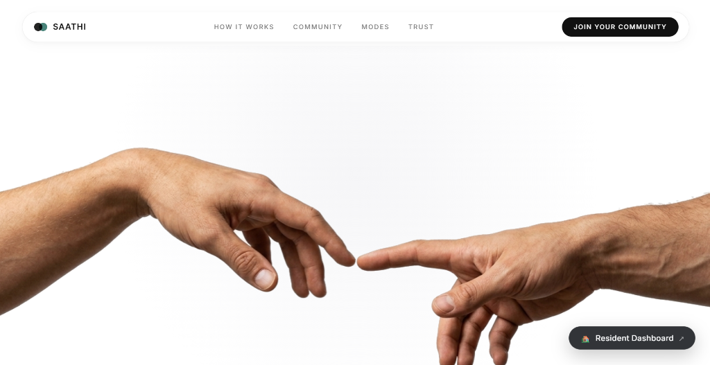
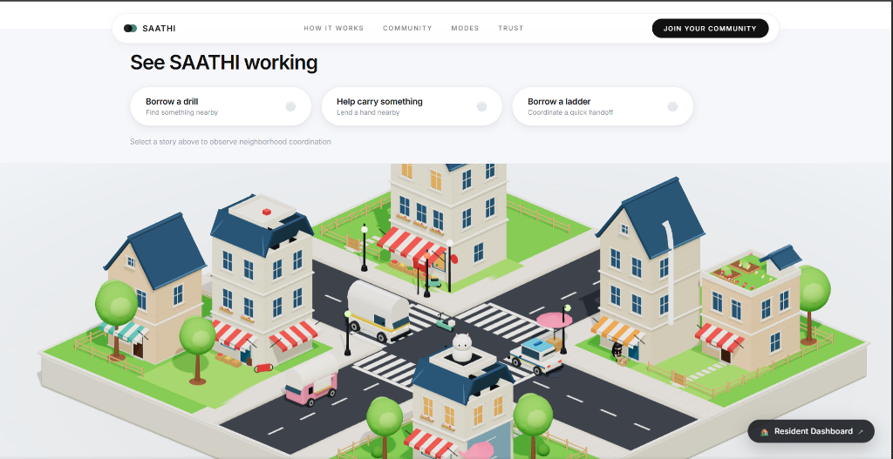

# SAATHI

### Everyday care meets real coordination.

SAATHI is a neighborhood coordination platform built around a simple idea:

**People in a neighborhood already have the ability to help each other. SAATHI gives that community a place to coordinate it.**

From everyday requests and shared resources to neighborhood-wide awareness, SAATHI brings local coordination into one structured, spatial experience.

---

## The Problem

Neighborhoods already contain everything needed for stronger communities:

* People willing to help
* Resources that could be shared
* Local knowledge
* Different needs and capabilities
* Existing relationships between neighbors

What is often missing is a **coordination layer**.

Important requests disappear in noisy group chats.
Useful resources remain invisible.
People who could help often don't know that help is needed.

SAATHI is being built to address that gap.

---

## The Product

SAATHI creates a dedicated digital layer for neighborhood coordination.

It combines community activity with a spatial representation of the neighborhood, allowing people to understand **what is happening, where it is happening, and where coordination is needed.**

### Core capabilities

| Capability         | What it enables                                |
| ------------------ | ---------------------------------------------- |
| **Requests**       | Surface needs within the neighborhood          |
| **Resources**      | Discover and coordinate useful local resources |
| **Coverage**       | Understand where support is available          |
| **Issues**         | Surface relevant neighborhood-level concerns   |
| **Spatial View**   | Explore neighborhood activity visually         |
| **Multiple Modes** | Adapt coordination to different situations     |

---

# Product Experience

## A Neighborhood, Not Just a Dashboard

SAATHI uses an interactive spatial environment to represent the community.

Instead of reducing a neighborhood to lists and notifications, the interface gives activity a **place**.

This creates a more intuitive way to understand local coordination at a glance.

---

## Screenshots

### Landing Page



### Neighborhood Experience



---

# Interface Overview

SAATHI structures neighborhood coordination across three primary interfaces:

* **Interactive 3D Spatial Diorama:** A Three.js spatial canvas representing community buildings, access roads, vehicles, and active neighborhood moments.
* **Neighborhood Dashboard:** A live coordination overview featuring neighborhood pulse metrics, resource discovery, active coverage requests, and issue tracking.
* **Contextual Coordination Surface:** Focused drawer and modal surfaces for initiating requests, coordinating resource handoffs, confirming returns, and raising neighborhood concerns.

---

# System Architecture

```text
+-----------------------------------------------------------------------+
|                              Web Browser                              |
|                 http://localhost:5173 (Vite Dev Server)               |
+-----------------------------------------------------------------------+
                                   |
                                   | HTTP / JSON REST
                                   v
+-----------------------------------------------------------------------+
|                            saathi-frontend                            |
|             React 19 + Three.js Spatial View + Framer Motion          |
|  - Spatial diorama, interactive buildings, and scenario directors     |
|  - Real-time dashboard, resource discovery, and coordination drawers  |
+-----------------------------------------------------------------------+
                                   |
                                   | Fetch API requests (VITE_API_BASE_URL)
                                   v
+-----------------------------------------------------------------------+
|                          saathi-api-updated                           |
|                Node.js + Express 4 REST API (Port 3000)               |
|  - Cookie/Token session context & actor authentication (Scrypt)       |
|  - Participant authorization & community hub boundaries               |
|  - State machines: resources, handoffs, issues, queries               |
+-----------------------------------------------------------------------+
                                   |
                                   | pg pool (DATABASE_URL, Port 5432)
                                   v
+-----------------------------------------------------------------------+
|                           PostgreSQL (v14+)                           |
|  - Relational schema with check constraints and integrity triggers    |
|  - Concurrency row locks (FOR UPDATE) & atomic state transitions      |
+-----------------------------------------------------------------------+
```

---

# Technology Stack

| Layer | Technology | Details / Role |
| :--- | :--- | :--- |
| **Frontend Framework** | React 19 (`react` 19.3) | Declarative UI components and state management |
| **Build & Tooling** | Vite 8 (`vite` 8.3) | Modern ESM development server and production bundler |
| **3D Spatial Graphics** | Three.js (`three` 0.186) | Interactive 3D neighborhood diorama and spatial canvas |
| **Animation & Motion** | Framer Motion (`framer-motion` 13.4) | UI layout transitions and micro-animations |
| **Smooth Scrolling** | Lenis (`lenis` 1.3) | Smooth page scrolling orchestration |
| **Icons** | Lucide React (`lucide-react` 1.49) | Clean, accessible SVG iconography |
| **Backend Runtime** | Node.js (v18.11+ / v20+) | CommonJS runtime supporting native `--watch` |
| **API Framework** | Express 4 (`express` 4.19) | HTTP routing, JSON middleware, and error handling |
| **Database Client** | `pg` (node-postgres 8.12) | Connection pooling, parameterized queries, and transactions |
| **Security & Auth** | Node.js `crypto` (`scrypt`) | Constant-time password hashing and token generation |
| **Database** | PostgreSQL (v14+) | Relational tables, foreign keys, enums, check constraints, and triggers |

---

# Project Structure

```text
shaathi/
├── saathi-frontend/                # React 19 + Vite frontend application
│   ├── src/
│   │   ├── api/                    # API client modules
│   │   ├── components/             # Reusable UI components
│   │   ├── dashboard/              # Dashboard views, modals, and pulse cards
│   │   ├── neighborhood/           # Three.js 3D diorama, props, and scenarios
│   │   ├── App.jsx                 # Main application root
│   │   └── main.js                 # Frontend entrypoint
│   ├── .env.example                # Frontend environment template
│   └── package.json                # Frontend scripts and dependencies
├── saathi-api-updated-003/
│   └── saathi-api-updated/         # Express + PostgreSQL backend API
│       ├── database/               # Frozen schema and migration SQL
│       ├── scripts/                # Database migrations and seed utilities
│       ├── src/
│       │   ├── middleware/         # Session context and role auth
│       │   ├── routes/             # Express route handlers
│       │   ├── services/           # Business logic and database transactions
│       │   ├── db.js               # PostgreSQL connection pool configuration
│       │   └── server.js           # Express application entrypoint
│       ├── tests/                  # Security, concurrency, and integration tests
│       ├── .env.example            # Backend environment template
│       └── package.json            # Backend scripts and dependencies
├── .gitignore                      # Repository ignore configuration
└── README.md                       # Repository overview and setup guide
```

---

# Local Setup Guide

Follow these steps to run SAATHI locally on your workstation.

### Prerequisites

* **Node.js:** v18.11+ or v20+ recommended (Node.js v18.11+ is required for the backend's native `--watch` flag).
* **npm:** v9+ (bundled with Node.js).
* **PostgreSQL:** v14+ (local PostgreSQL service or accessible managed database).

---

### Step 1 — Clone Repository

```bash
git clone https://github.com/ayushrajroshan123-code/Shaathi-.git shaathi
cd shaathi
```

---

### Step 2 — Database Setup & Backend Configuration

1. **Create Database:** Ensure PostgreSQL is running and create a local database:
   ```bash
   createdb saathi
   ```
   *(Or run `CREATE DATABASE saathi;` inside your `psql` console.)*

2. **Navigate to Backend Directory:**
   ```bash
   cd saathi-api-updated-003/saathi-api-updated
   ```

3. **Install Dependencies:**
   ```bash
   npm install
   ```

4. **Configure Environment:** Copy the template to `.env`:
   - On Linux/macOS:
     ```bash
     cp .env.example .env
     ```
   - On Windows (PowerShell):
     ```powershell
     Copy-Item .env.example .env
     ```

5. **Edit `.env` Configuration:**
   Open `.env` and configure your database parameters:
   - `DATABASE_URL`: `postgres://<user>:<password>@localhost:5432/saathi`
   - `PORT`: Server port (defaults to `3000`).
   - `ALLOWED_ORIGINS`: Allowed CORS origins (`http://localhost:5173,http://127.0.0.1:5173` for local development).
   - `DATABASE_SSL`: Set to `false` for local connections; set to `require` for managed cloud databases.
   - `ENABLE_EMERGENCY_ROUTES`: Set to `false` (default) for Phase 1 scope; set to `true` if evaluating emergency routes.

6. **Run Migrations & Verify Schema:**
   Run the migration scripts to initialize the database:
   ```bash
   # Preview pending migration SQL statements
   npm run migrate:dry-run

   # Apply schema migrations
   npm run migrate

   # Verify database matches canonical schema
   npm run verify-schema

   # Optional: Seed development fixture data
   npm run db:seed
   ```

7. **Start Backend Server:**
   ```bash
   npm run dev
   ```
   The backend API will start on `http://localhost:3000`.

---

### Step 3 — Frontend Setup

1. **Open a New Terminal and Navigate to Frontend Directory:**
   ```bash
   cd saathi-frontend
   ```

2. **Install Dependencies:**
   ```bash
   npm install
   ```

3. **Configure Environment:** Copy the frontend template to `.env`:
   - On Linux/macOS:
     ```bash
     cp .env.example .env
     ```
   - On Windows (PowerShell):
     ```powershell
     Copy-Item .env.example .env
     ```

4. **Verify Frontend Environment Variables:**
   Open `.env` and confirm:
   - `VITE_API_BASE_URL`: Base URL of the backend API (defaults to `http://localhost:3000` in local dev).
   - `VITE_DEMO_MODE`: Set to `false` (default) for standard development.

5. **Start Frontend Development Server:**
   ```bash
   npm run dev
   ```
   The frontend application will be accessible at `http://localhost:5173`.

---

### Required Services Summary

To run the complete application locally, ensure all three services are active:

| Service | Address / Port | Start Command |
| :--- | :--- | :--- |
| **PostgreSQL Database** | `localhost:5432` | System service / PostgreSQL daemon |
| **Backend API** | `http://localhost:3000` | `npm run dev` (in `saathi-api-updated-003/saathi-api-updated`) |
| **Frontend Web App** | `http://localhost:5173` | `npm run dev` (in `saathi-frontend`) |

---

# Feature Status & Architectural Boundaries

SAATHI is an actively developed product prototype. The codebase clearly delineates implemented core functionality, gated features, and planned architectural scope.

### Implemented Core Features

* **Interactive Landing Experience:** Public 3D diorama canvas, hero narrative, and smooth-scrolling community sections.
* **Neighborhood Dashboard:** Live pulse counters, coverage status, active community requests, and spatial viewport.
* **Authentication & Sessions:** Token/cookie session context, constant-time Scrypt password hashing, and role verification (`resident`, `coordinator`).
* **Resource Sharing Lifecycle:** Community inventory discovery, borrowing requests, owner approval/declining, cancelation, and return handoff flows.
* **Single Active Possession Invariant:** Atomic locking (`SELECT ... FOR UPDATE`) prevents concurrent double-booking of resources during approval.
* **Coverage Requests:** Requests for neighborhood presence/support with access-handoff status transitions.
* **Neighborhood Issues:** Local issue tracking (`reported`, `in_progress`, `attention_needed`, `resolved`) with transition validation.
* **Community Queries:** Shared neighborhood interest queries (`GET /queries`, `POST /queries`).

### Gated Features (Require Explicit Configuration)

* **Emergency & SOS Routes (`/incidents`, `/sos-events`, `/emergency-alerts`):** The emergency routing and service layer is implemented in code but strictly gated behind `ENABLE_EMERGENCY_ROUTES=true` in `src/app.js`. Emergency routes remain disabled by default in standard deployments to preserve Phase 1 pilot scope.
* **Demo Persona Convenience Login:** Fictional persona shortcuts on the frontend are gated behind `VITE_DEMO_MODE=true` in `saathi-frontend/.env`. In the backend, demo resets and seeders require explicit guards (`DEMO_MODE=true`, `ALLOW_DEMO_RESET=true`, `EXPECTED_DEMO_DB_NAME=saathi_demo`, `EXPECTED_DEMO_ROLE=...`) targeting only dedicated demo instances.

### Explicit Limitations & Planned Scope

* **Multi-Hub Isolation:** Authorization is enforced at the record level for participants and coordinators, and UUIDs prevent record enumeration. However, general listing endpoints currently scope by query parameters rather than physical schema-level tenant partitioning. Full multi-tenant isolation is planned for future phases.
* **Calendar-Based Resource Scheduling:** The current concurrency control verifies immediate active availability at the moment of request approval. Advanced forward-looking calendar scheduling and overlapping future time-slot bookings are planned for later phases.
* **Issue Assignee Tracking:** Moving an issue to `in_progress` signifies neighborhood-level action; individual member assignment workflows are not currently tracked in the database schema.
* **Event Audit Trail:** Status updates modify records in place; durable event audit log tables are not yet implemented.

---

# Philosophy

Technology should not replace the relationships that already exist in a neighborhood.

It should make those relationships **easier to activate when they matter.**

**Everyday care meets real coordination.**

---

# Development

This repository represents an actively evolving product.

The public codebase provides visibility into the project and its implementation while keeping certain product, business, and internal architectural details intentionally undisclosed.

---

# License

No open-source license has currently been granted for this repository.
